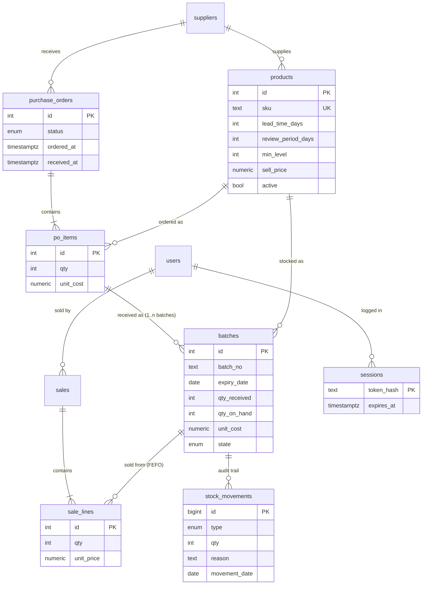

# Architecture

## Layers

```
public/ (browser SPA, no build)           ← html`` escapes everything; never sees costs as staff
   │  fetch /api/* (cookie session)
src/app.js          security headers, JSON body limit, error → status mapping
src/routes/api.js   auth, role checks, :id validation, cost stripping for staff
src/services/*      transactions + SQL (sales, purchasing, inventory, forecasting, auth)
src/domain/, src/forecast/   PURE functions: FEFO, batch status, model, backtest, reorder, risk
PostgreSQL          constraints are the last line of defence (qty ≥ 0, on_hand ≤ received, FKs)
```

Business rules live in pure functions so they can be unit-tested without a database. The services only load rows, call those functions, and write the results in one transaction.

## Data model



* **Batch = unit of stock.** Each received PO line creates one or more batches. `qty_on_hand` is decremented by sales and zeroed by a write-off.
* **`stock_movements` is append-only:** every receipt (+), sale (−) and write-off (−) with who, when and why.
* **`daily_sales` (view)** aggregates sale lines per product per day. It is the forecaster's only input.
* **Constraints:** `CHECK (qty_on_hand >= 0 AND qty_on_hand <= qty_received)`, positive quantities, unique SKU, and a unique product per PO. A partial index `batches_fefo_idx (product_id, expiry_date, id) WHERE state='active' AND qty_on_hand > 0` serves the FEFO lookup.
* **Migrations:** `db/migrations/NNN_*.sql`, applied in order inside a transaction and recorded in `schema_migrations`. `npm run migrate` is safe to repeat; `npm run db:reset` is for development only.

## A sale, step by step

```
POST /api/sales {items:[{productId, qty}]}
 → validate (whole numbers, ≤ 100 000, ≤ 100 lines), merge duplicate lines
 → BEGIN
 → for each product (ascending id, so two sales can't deadlock):
      SELECT … FROM batches WHERE product_id=$1 AND state='active' AND qty_on_hand>0
        ORDER BY expiry_date, id FOR UPDATE           ← a concurrent sale waits here
      allocateFefo(rows, qty, today)                  ← pure: skip expired, earliest first
      not enough → throw 409 "বিক্রয়যোগ্য stock 5 (3টা মেয়াদোত্তীর্ণ বাদ)" → ROLLBACK (nothing written)
      UPDATE batches, INSERT sale_lines, INSERT stock_movements per pick
 → COMMIT → receipt with the batch used for each unit
```

## API

All endpoints are under `/api`, use JSON, and authenticate with a session cookie (`httpOnly`, `SameSite=Strict`). 🔒 = owner only.

| Method | Path | Purpose |
|---|---|---|
| POST | `/auth/login`, `/auth/logout` | Session (login is throttled: 5 failures / 15 min per username) |
| GET | `/me` | Current user + business date |
| GET | `/products` · `/suppliers` | Catalogue with live stock figures (usable, expired, near expiry, on order, next expiry) |
| POST/PATCH 🔒 | `/products[/:id]` · `/suppliers[/:id]` | Add / edit |
| GET | `/batches?productId=` · `/alerts/expiry` | Batches with derived status; expired + near-expiry list |
| POST 🔒 | `/batches/:id/write-off` | Write off with a reason (recorded in history) |
| GET 🔒 | `/stock-history?productId=` | Movement log |
| POST · GET | `/sales` | FEFO sale (atomic, row-locked) · recent sales |
| GET | `/summary` | Today's takings + 14-day trend |
| GET | `/purchase-orders[?status=]` · `/purchase-orders/:id` | List / detail |
| POST 🔒 | `/purchase-orders` · `…/:id/place` · `…/:id/cancel` | Create draft · Draft→Ordered · cancel |
| PUT 🔒 | `/purchase-orders/:id/items` | Edit a draft |
| POST | `/purchase-orders/:id/receive` | Ordered→Received; each line becomes a batch (staff can't set the cost) |
| GET 🔒 | `/forecast/:productId` | History, 14-day forecast, reorder breakdown, expiry risk, backtest, outlook |
| POST 🔒 | `/forecast/:productId/draft-po` | Draft PO from the recommendation |
| GET · POST 🔒 | `/reorder-plan` · `/reorder-plan/draft-pos` | All products by urgency · draft POs grouped by supplier |
| GET 🔒 | `/model-report` | Walk-forward backtest, model vs baselines |
| GET/POST/PATCH 🔒 | `/users[/:id]` | Staff management |

Errors are always `{ "error": "human message", "details"?: {…} }`:
* 400 for invalid input
* 401 when not logged in
* 403 for the wrong role
* 404 when something doesn't exist
* 409 for a business-rule conflict (insufficient stock, wrong PO state, duplicate SKU)
* 429 when login is throttled

The server never returns a stack trace.

## Security summary

| Threat | Control |
|---|---|
| SQL injection | Parameterised queries only; identifiers are never built from input |
| XSS | Every value interpolated into HTML is escaped (`html`` ` template); CSP blocks inline scripts and third-party script origins |
| CSRF | `SameSite=Strict` session cookie; JSON-only API |
| Session theft | `httpOnly` cookie; only the SHA-256 of the token is stored; 7-day expiry; logout deletes it; disabling a user deletes their sessions |
| Password guessing | scrypt hashes with a per-user salt; login throttle (429 + `Retry-After`); same message and timing for unknown user vs wrong password |
| Privilege escalation | Role checked server-side on every owner route; staff responses have cost fields removed centrally |
| Bad input | Validation at the edge (whole numbers, bounds, text length, enums); DB `CHECK` constraints behind it; a malformed request gets a 400, never a 500 |
| Clickjacking / sniffing | `frame-ancestors 'none'`, `X-Frame-Options: DENY`, `nosniff`; API responses are `Cache-Control: no-store` |
